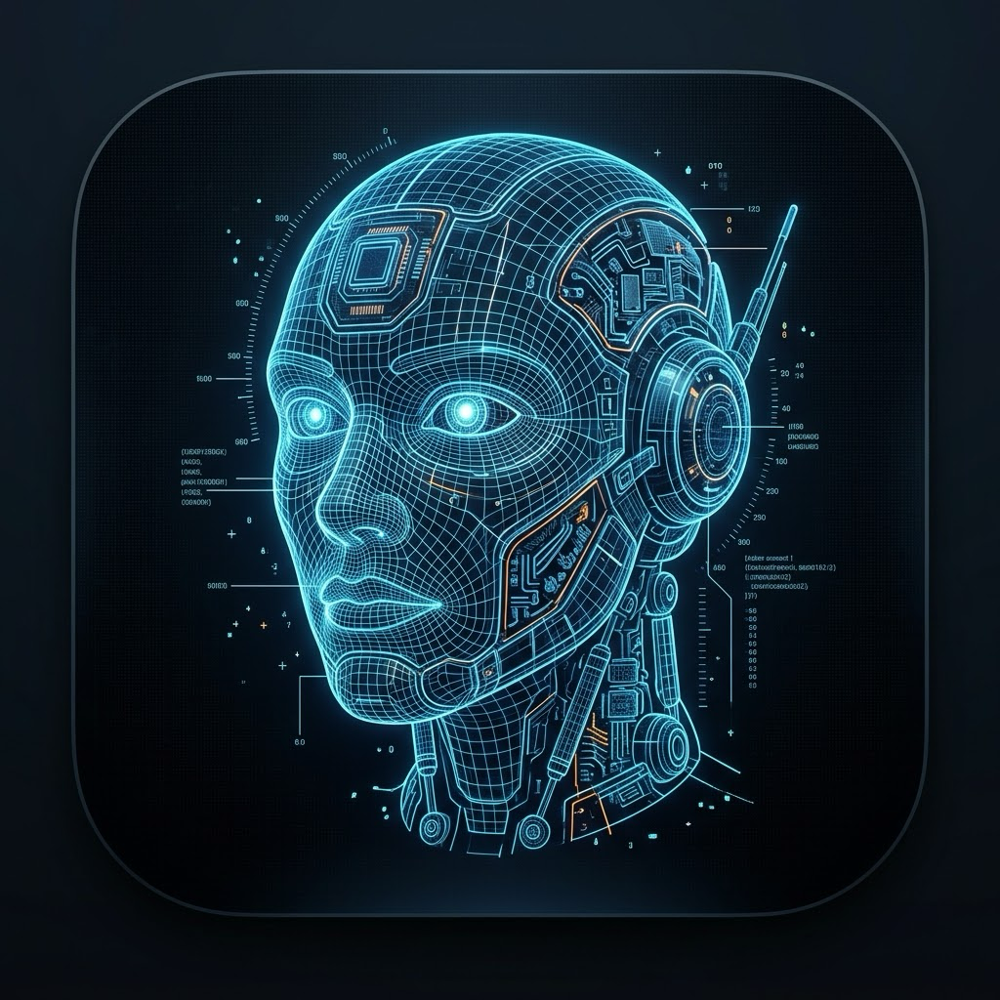

# JARVIS · CHEN // OS (Desktop Autonomous AI Agent Core)

<p align="center">
  
</p>

<p align="center">
  <b>桌面级全双工私人 AI 智能体 // 3D 全息赛博交互中枢</b>
</p>

<p align="center">
  
  
  
  
  
</p>

---

## 🌟 项目亮点

* 🎙️ **全双工智能交互**：支持热词实时语音唤醒（“贾维斯”）、连续语音对话、自动断句与回声抑制。
* 🌐 **3D 全息视觉中枢**：基于 Three.js 打造的 3D 赛博机械人物头像与实时发音嘴型动力学引擎（Lip-Sync），随音频频谱自然张合。
* 🧠 **大模型决策与原生降级**：
  * **Function Calling 调度**：原生兼容 **DeepSeek**、**阿里通义千问 (Qwen)**、**月之暗面 (Kimi)**、**智谱 (GLM)**、**OpenAI** 与本地 **Ollama**。
  * **离线降级守护**：未配置 API Key 或断网时，内置毫秒级轻量语义路由器无缝接管，核心指令依然秒级响应。
* 🖥️ **OS 底层控制工具链**：
  * **应用启停**：自动识别 macOS / Windows 跨平台调起微信、网易云音乐、计算器、画图、VSCode 等。
  * **媒体播放**：唤醒客户端或自动检索网页流媒体。
  * **生活与日历**：本地 SQLite 结构化长短期记忆存储与日程管理。
  * **系统体检**：实时感知 CPU、内存、电池、系统负载等硬件指标。
* 🔊 **影视级拟人语音**：集成微软神经网络高品质男声（Edge-TTS），支持端侧 Web Speech 自动降级保护。
* 🔒 **隐私至上设计**：所有会话历史、日历数据与用户偏好均存储在本地 SQLite 数据库中，敏感凭证严格存放在本地 `.env`，绝不上传云端。

---

## 📂 项目结构

```text
jarvis-os-agent/
├── backend/                  # Python FastAPI 智能体服务端
│   ├── server.py             # 核心 API 与静态资产托管
│   ├── agent_brain.py        # 大模型规划、Function Calling 与语义路由
│   ├── os_tools.py           # 操作系统工具链（应用控制、音乐、日历等）
│   └── memory_manager.py     # SQLite 本地持久化记忆引擎
├── frontend/                 # 赛博朋克 HUD 前端界面
│   ├── index.html            # HUD 页面结构
│   ├── style.css             # 科技感深空霓虹样式
│   ├── particles.js          # 3D 全息人物与声波唇形同步引擎
│   ├── speech.js             # STT 识别、TTS 合成与音频频谱流
│   └── app.js                # 前端交互与 API 通信
├── desktop-electron/         # Electron 桌面端原生应用封装
│   ├── main.js               # 主进程守护与全局快捷键（Cmd+Shift+J）
│   └── package.json          # 桌面端依赖与打包配置
├── data/                     # 本地持久化数据目录（受 .gitignore 保护）
├── .env.example              # 环境变量配置模板
├── .gitignore                # Git 安全与忽略规则
├── LICENSE                   # 开源许可协议 (MIT)
├── README.md                 # 项目说明文档
├── requirements.txt          # Python 依赖清单
├── run_desktop.command       # macOS 双击桌面启动脚本
├── desktop_app.py            # 基于 pywebview 的原生轻量启动器
└── start.py                  # 一键启动服务端入口
```

---

## 🚀 极速上手

### 1. 克隆项目与安装 Python 依赖

```bash
git clone https://github.com/your-username/jarvis-os-agent.git
cd jarvis-os-agent

# 安装后端依赖
pip install -r requirements.txt
```

### 2. 配置大模型密钥（可选）

复制配置文件模板：
```bash
cp .env.example .env
```
编辑 `.env` 填入您的 API 密钥（以 DeepSeek 为例）：
```env
LLM_API_KEY=sk-您的实际Key
LLM_BASE_URL=https://api.deepseek.com/v1
LLM_MODEL=deepseek-chat
```
> **提示**：即使不填 `.env`，系统内置的离线语义路由依然可以完美执行所有系统工具与基础指令。

### 3. 一键启动

#### 方式 A：启动 Web HUD 服务
```bash
python3 start.py
```
启动后在浏览器打开：[http://localhost:8765/app/](http://localhost:8765/app/)

#### 方式 B：启动 Electron 独立桌面客户端（推荐）
```bash
cd desktop-electron
npm install
npm start
```
* **全局唤醒快捷键**：按下 `Command + Shift + J`（Mac）或 `Ctrl + Shift + J`（Windows）即可随时呼出/隐藏贾维斯。

---

## 🛡️ 安全与隐私声明 (Security & Privacy)

* **零云端上报**：本项目不会向任何开发者服务器发送遥测信息、统计数据或私有日志。
* **本地数据隔离**：所有本地记忆、日程和聊天日志保存在 `data/*.db` 中，受 `.gitignore` 保护，绝不会被意外提交至代码库。
* **密钥保护**：真实 API 密钥仅由本地 `.env` 载入，永远不要将您的 `.env` 上传到任何公开仓库。

---

## 📄 开源许可证

本项目基于 [MIT License](LICENSE) 开源发布。
